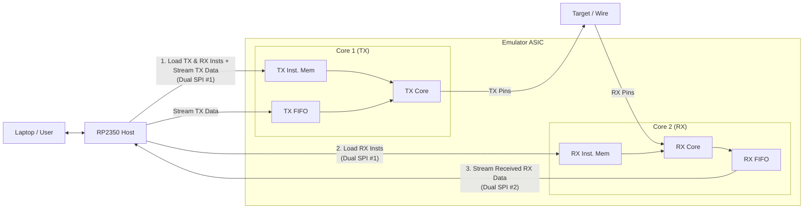

# Architecture

## Goal

Build a **post-silicon reconfigurable serial protocol emulator ASIC** (targeting Tiny Tapeout) that adapts to multiple wire protocols after tapeout without hardware redesigns or slow host-CPU bit-banging.

* **Programmable Dual-Core Sequencer:** Separate TX and RX engines driven by compact instructions from the RP2350 host to handle timing, framing, and pin directionality.
* **Independent / Bridge Operation:** TX and RX can run different protocols or directions simultaneously.

### Supported Serial Protocols

| S.No | Protocol | Role & Direction | Primary Wire / Timing Model |
| --- | --- | --- | --- |
| 1 | UART | TX & RX | Asynchronous serial, configurable baud prescaler, start/data/parity/stop bits |
| 2 | I2C | Controller & Target | Synchronous open-drain (`SDA`, `SCL`), ACK/NACK, clock stretching |
| 3 | Ethernet (10BASE-T) | 10 Mbps Half-Duplex (TX + Comparator RX) | `50 ns` half-bit Manchester timing, dual-pin TX (`tx_p`, `tx_n`), external comparator RX |

### Sub-Features & Speeds Checklist

#### 1. UART

| Sub-Feature / Speed | Supported | Not Supported | Notes |
| --- | --- | --- | --- |
| Configurable baud rates (via 12-bit prescaler) | [x] | [ ] | e.g., 9600 up to multi-Mbps within clock/pin limits |
| Configurable frame lengths (5–9 data bits, optional parity, 1–2 stop bits) | [x] | [ ] | Framed in FIFO / sequencer config |
| LSB-first serialization & start-bit edge sync | [x] | [ ] | Standard UART framing |
| Hardware flow control (RTS/CTS) | [ ] | [x] | Out of scope unless mapped to spare I/O |
| Automatic baud-rate detection | [ ] | [x] | Out of scope |

#### 2. I2C

| Sub-Feature / Speed | Supported | Not Supported | Notes |
| --- | --- | --- | --- |
| Standard Mode (100 kHz) | [x] | [ ] | Supported |
| Fast Mode (400 kHz) | [x] | [ ] | Supported |
| High-Speed Mode (3.4 MHz) & Ultra-Fast Mode | [ ] | [x] | Not supported |
| Open-drain signaling (`uio_oe` drive low / Hi-Z release) | [x] | [ ] | Uses external pull-ups |
| `START`, `Repeated START`, and `STOP` sub-bit phases | [x] | [ ] | Coordinated via phase steps/timing |
| 7-bit addressing, 8-bit MSB-first data, 9th-bit ACK/NACK | [x] | [ ] | Supported |
| Clock stretching (`WAIT_EVT` on `SCL` low / RX FIFO hold) | [x] | [ ] | Supported |
| Multi-master bus arbitration | [ ] | [x] | Not supported |
| Native 10-bit addressing | [ ] | [x] | Not supported (unless framed by host) |

#### 3. Ethernet (10BASE-T)

| Sub-Feature / Speed | Supported | Not Supported | Notes |
| --- | --- | --- | --- |
| 10 Mbps (`10BASE-T`, `50 ns` half-bit / Manchester TX) | [x] | [ ] | Via `tx_p`, `tx_n` + 4-resistor network + MagJack |
| 100 Mbps (`100BASE-TX`) & 1 Gbps+ | [ ] | [x] | Not supported |
| 0V differential idle (`00`) & 100 ns link pulses every 16 ms | [x] | [ ] | Supported via TX output / host framing |
| RX via external comparator IC (e.g., SN65LVDS2) to RX FIFO | [x] | [ ] | Single-ended digital input into ASIC |
| Direct analog differential RX on ASIC pads | [ ] | [x] | No analog pads; requires external comparator |
| On-chip MAC/IP framing, CRC calculation, CSMA/CD | [ ] | [x] | Handled on RP2350 host |

---

## Basic Architecture

Instead of a power-hungry general CPU or rigid hardwired state machines for each protocol, the ASIC uses a **programmable serial sequencer** split into **two independent cores** (**Core 1 / TX** and **Core 2 / RX**), running at **60–66 MHz** inside a **32-tile (~1 mm²)** Tiny Tapeout budget.

### System Blocks

* **Core 1 (TX Path):** Contains a **TX Instruction Memory**, a **TX FIFO**, and a **TX Sequencer Core**. It reads microcode instructions, pulls outgoing bits/phases from the TX FIFO, paces timing with a clock divider, pauses on events when needed, and drives output/bidirectional pins.
* **Core 2 (RX Path):** Contains an **RX Instruction Memory**, an **RX Sequencer Core**, and an **RX FIFO**. It samples/recovers incoming signals according to its loaded instructions, pushes captured bits/bytes into the RX FIFO without storing full frames, and drains data out to the RP2350.
* **Host Interface & Address Decoder:** Connects the RP2350 to the ASIC using **two Dual SPI links**:
* **Dual SPI #1 (RP2350 → ASIC):** Routes writes by address to Core 1's instruction memory, Core 2's instruction memory, or the TX FIFO.
* **Dual SPI #2 (ASIC → RP2350):** Streams captured RX data out of the RX FIFO to the RP2350.


* **Pin & Lane Conditioning:** Supports single-lane or configurable two-lane (`DUAL_LANE`) pin stepping alongside external board circuitry where required:
* **I2C (`[PF-1]`, `[PF-2]`, `[PF-3]`):** Open-drain drive/release (`uio_oe`) with external pull-ups, `DUAL_LANE` for coordinated `START`/`STOP` phases, and event waiting for clock stretching.
* **10BASE-T Ethernet (`[PF-4]`, `[PF-5]`):** `DUAL_LANE` differential-style TX pair driving external resistors + MagJack on output, and an external comparator converting sub-2.5V differential RX to TTL on input.

### How the Cores Work Together

| Aspect | Core 1 (TX) | Core 2 (RX) |
| --- | --- | --- |
| **Primary Job** | Generate timed bit/phase streams onto external pins | Sample/recover incoming wire signals into the RX FIFO |
| **Instruction Source** | TX Instruction Memory (loaded via Dual SPI #1) | RX Instruction Memory (loaded via Dual SPI #1) |
| **Data Path** | TX FIFO (via Dual SPI #1) → TX Core → Pins | Pins → RX Core → RX FIFO → Dual SPI #2 |
| **Independence** | Runs on its own clock divisor, PC, and wait state | Runs independently—can use a different protocol/rate simultaneously |

---

## Assumptions

* **RP2350 Host:** Sits on the board alongside the ASIC; no dedicated `IRQ` pin needed since the RP2350 has no other heavy tasks.
* **24 Digital Pins:** `8` inputs (`ui_in`), `8` outputs (`uo_out`), `8` bidirectional (`uio`), plus `clk`, `rst_n`, `ena` (no analog pads; internal mixed-signal allowed if precheck passes).
* **Reference & Clock:** Uses Tiny Tapeout top-level wrapper (`mtaneer` reference) with a **60–66 MHz** external clock from the RP2350/board.
* **External Conditioning:** Pull-ups for I2C (`SDA`/`SCL`); 4-resistor network + MagJack (TX) and external comparator IC (RX) for 10BASE-T Ethernet.

---

## Constraints

* **Area:** 32 tiles (`8×4`, ~`1.0 mm²`), ~`1K` logic cells/tile (**~32K logic cells total**; pre-silicon estimates).
* **No External RAM:** Instruction memory and FIFOs must fit on-chip.
* **I/O & Timing:** Max **24 pins**, pin toggle limit **~60 MHz** (~`66 MHz` pre-silicon estimate), and **~10 ns** pad/mux round-trip delay.
* **Clock:** **60 MHz** (~`16.67 ns` cycle) or up to **66 MHz** external clock.

---

## Similarities Across Target Protocols

All three protocols move bits or signal phases over time—which motivates one programmable serial engine instead of separate hardwired FSMs or RP2350 bit-banging.

* **Pins:** UART uses 2 lines (`TX`, `RX`), I2C uses 2 open-drain lines (`SDA`, `SCL`), and 10BASE-T Ethernet uses 2 differential pairs (`TX+`/`TX-`, `RX+`/`RX-` via external conditioning/comparator). All map to 1-lane or 2-lane stepping.
* **Speed & Timing:** UART is baud-prescaled (e.g., 9.6 kbps–multi-Mbps), I2C is clocked at 100/400 kHz, and 10BASE-T runs at 10 Mbps (`50 ns` half-bits). All derive timing from a `SET_DIV` divider off the `60–66 MHz` clock.
* **Frame Structure:** All send/receive ordered bit sequences—UART start/data/parity/stop frames, I2C address/ACK/data frames between `START` and `STOP`, and Ethernet bit/half-bit streams—handled by configurable frame lengths (`CFG_FRAME`) and shifting (`XFER_FRM`).

### Peculiar Features & Architectural Tweaks

Each protocol introduces wire-level quirks that forced specific additions to our simple sequencer architecture (referenced in **Basic Arch** and **Instruction Set**):

* **[PF-1] I2C Open-Drain Signaling (`SDA` / `SCL`):** I2C drives `0` and releases to `1` via pull-ups rather than push-pull high. *Arch tweak:* `uio_oe` controls drive vs. Hi-Z release per lane rather than driving `1` actively.
* **[PF-2] I2C `START`, `Repeated START`, and `STOP` Transitions:** `START` and `STOP` depend on coordinated `SDA` changes while `SCL` is high, not uniform bit shifts. *Arch tweak:* Added **`DUAL_LANE` mode in `CFG_FRAME**` so two lines (`{SCL, SDA}`) can step together across sub-bit phases—which also aligns directly with driving two differential pins in **10BASE-T Ethernet**.
* **[PF-3] I2C Clock Stretching (`SCL` Held Low):** A target device can hold `SCL` low to stall the bus (or our RX side can hold `SCL` low when its FIFO nears full). *Arch tweak:* Added **`WAIT_EVT`** (`SCL_HIGH` / event conditions) so the sequencer pauses without busy-polling or corrupting bit timing.
* **[PF-4] 10BASE-T Differential Two-Pin TX (`tx_p`, `tx_n`), Idle (`00`) & Link Pulses:** Ethernet TX is differential, requiring two pins (`tx_p`, `tx_n`) driven synchronously with a 0V idle state (`00`), periodic link pulses, and an external 4-resistor + MagJack network. *Arch tweak:* `DUAL_LANE` steps `{tx_p, tx_n}` pairs at `50 ns` half-bit intervals (`SET_DIV`).
Aha, got it—keeping it accurate to what the comparator actually does: it simply takes the attenuated/sub-2.5V differential RX signal and converts it into a clean TTL/CMOS logic level for the pin, without doing clock/edge recovery or squelch itself.
* **[PF-5] 10BASE-T Ethernet RX Differential-to-TTL Conversion & Stream Drain:** Incoming differential RX signals can drop below standard 2.5V/3.3V logic thresholds and carry no separate clock wire. *Arch tweak:* An external comparator converts the differential RX pair to a clean TTL signal for a single input pin, while the RX path samples/recovers the bitstream and drains into the RX FIFO over Dual SPI on a half-full watermark or idle timeout (without needing whole-frame buffering in the emulator).

---

## Data Flow



### Basic Flow (Main Goal)

1. **User Command:** The user clicks a button on the laptop, telling the **RP2350** what to transmit, receive, or both.
2. **TX Setup & Streaming (Core 1):** Over **Dual SPI #1**, the RP2350 writes **instructions** describing the protocol into **Core 1 (TX)**. Once configured, the RP2350 simply **streams the data** to be sent into the TX FIFO, and Core 1 shifts it out to the wire.
3. **RX Setup & Streaming (Core 2):** Because the RP2350 isn't the master on Dual SPI #2, it sends the **RX instructions** to be loaded into **Core 2 (RX)** over **Dual SPI #1**. Once loaded, **Core 2 starts streaming the received data** back to the RP2350 over **Dual SPI #2**.

### Extra Points (Implementation Details)

* **Independent Cores:** Core 1 (TX) and Core 2 (RX) are independent, so they can run different protocols or operate at different times without interfering with each other.
* **Configurable Lane Width & Waits:** `DUAL_LANE` (`CFG_FRAME`) lets a core step 1 lane (`DUAL_LANE = 0`) or 2 lanes together (`DUAL_LANE = 1`, e.g., `{tx_p, tx_n}` for 10BASE-T TX `[PF-4]` or `{SCL, SDA}` for I2C `START`/`STOP` phases `[PF-2]`), while `WAIT_EVT` handles pauses like I2C clock stretching (`[PF-3]`).
* **External Conditioning:** I2C uses external pull-ups (`[PF-1]`), 10BASE-T TX uses 4 resistors + MagJack (`[PF-4]`), and 10BASE-T RX uses an external comparator to convert differential signals to TTL (`[PF-5]`).
* **RX FIFO Drain & Framing:** Core 2 does not buffer whole frames (`[PF-5]`); the RX FIFO streams data back to the RP2350 over Dual SPI #2 on a **half-full watermark** or **idle timeout**, starting with a byte count when sending odd byte counts.

---

## Sequencer Instruction Set & Examples

Both the **TX Core (Core 1)** and **RX Core (Core 2)** execute lightweight **16-bit instructions** tailored to serial bit/phase timing and bus/FIFO synchronization. Instead of writing complex control logic in hardware, the RP2350 loads a short sequence of instructions into the target core's instruction memory (via Dual SPI #1) to define how that core behaves.

### Instruction Format (16-bit)

* **Bits `[15:12]` (4 bits): Opcode** — Selects the instruction (`SET_DIV`, `CFG_FRAME`, `WAIT_EVT`, `XFER_FRM`, `SET_PC`).
* **Bits `[11:0]` (12 bits): Operand / Immediate** — Holds a clock divisor, frame size/mode flags (including `DUAL_LANE`), an event code, transfer options, or a jump address (`0` to `4,095`).

### Core Instructions

| Mnemonic | What It Does | Key Operands & Behavior | Why It Matters |
| --- | --- | --- | --- |
| **`SET_DIV`** | Sets timing tick length | 12-bit clock divisor (`cycles per bit`, half-bit, or sub-bit phase) | Paces UART, I2C, and 10BASE-T timings from the `60–66 MHz` clock without clock muxes |
| **`CFG_FRAME`** | Configures frame & lane width | Bit/phase count, mode flags, and `DUAL_LANE` (`0` = 1 lane, `1` = 2 lanes) | Lets a single core handle normal serial bits or coordinated 2-pin steps (`[PF-2]`, `[PF-4]`) |
| **`WAIT_EVT`** | Pauses until a condition holds | Event selector (e.g., `FIFO_NE`, `SCL_HIGH`, edge/event trigger) | Avoids busy-polling loops and handles stalls like I2C clock stretching (`[PF-3]`) |
| **`XFER_FRM`** | Shifts or samples a frame/chunk | Transfer direction/mode with FIFO and lane/open-drain behavior (`[PF-1]`) | Moves a configured bit/phase sequence cleanly once setup is done |
| **`SET_PC`** | Jumps to an instruction address | Target address (`0` to `4095`) | Enables loops and branches (such as repeating per frame or packet chunk) |

### How `WAIT_EVT` Works

Normally, the core steps to `PC + 1` after finishing an instruction. When **`WAIT_EVT`** runs, the core **holds on the current instruction** until the selected condition becomes true, then advances:

* **Waiting for data (`FIFO_NE`):** If the TX FIFO is empty, the TX Core waits cleanly instead of shifting stale bits or spinning in a software loop.
* **Waiting for a bus line (`SCL_HIGH` `[PF-3]`):** In I2C, a target device can hold `SCL` low (clock stretching). Waiting on `SCL_HIGH` keeps the core paused until the line is actually released high.

### Protocol Examples

#### 1. UART TX (`60 MHz` Clock → `115,200` Baud, `8N1`, Single Lane)

* **Timing:** `60,000,000 / 115,200 ≈ 521` clock cycles per bit (`521 <= 4095`).
* **Lane mode:** `DUAL_LANE = 0` (single output pin). The RP2350 streams 10-bit frames (`start=0`, `8 data bits`, `stop=1`) into the TX FIFO.

```asm
; RP2350 pushes 10-bit UART frames into TX FIFO (bit 0 = start 0, bits 8:1 = data, bit 9 = stop 1)
    SET_DIV   521                  ; ~521 cycles/bit (~115,200 baud @ 60 MHz)
    CFG_FRAME 10, TX_UART, LANE1   ; 10-bit frame, single-lane mode (DUAL_LANE = 0)
    WAIT_EVT  FIFO_NE              ; Pause until TX FIFO has data
    XFER_FRM  TX                   ; Shift out 10 bits at 521 cycles per bit
    SET_PC    0x2                  ; Loop back to WAIT_EVT for the next frame

```

#### 2. 10BASE-T Ethernet TX (`60 MHz` Clock → `10 Mbps` Half-Bits via `DUAL_LANE`)

* **Timing:** At `10 Mbps`, one bit is `100 ns` and one half-bit is `50 ns`. At `60 MHz` (`~16.67 ns` per cycle), **3 clock cycles = 50 ns** (`[PF-4]`).
* **Lane mode:** `DUAL_LANE = 1` so two pins (`{tx_p, tx_n}` pair before external resistors/MagJack `[PF-4]`) step together as a half-bit pair. Similarly, `DUAL_LANE = 1` can step `{SCL, SDA}` together during I2C `START` / `Repeated START` / `STOP` phases (`[PF-2]`), with open-drain release (`[PF-1]`) and `WAIT_EVT` (`[PF-3]`).

```asm
; RP2350 streams pre-packed dual-lane ({tx_p, tx_n}) half-bit words into TX FIFO
; At 60 MHz, 3 clock cycles = 50 ns half-bit step
    SET_DIV   3                    ; 3 clock cycles per half-bit step @ 60 MHz
    CFG_FRAME 8, TX_ETH, DUAL_LANE ; 8 half-bit steps per chunk, 2-lane mode (DUAL_LANE = 1)
    WAIT_EVT  FIFO_NE              ; Pause until TX FIFO has half-bit pairs
    XFER_FRM  TX                   ; Drive 2-lane steps every 3 cycles
    SET_PC    0x2                  ; Loop back to WAIT_EVT for next chunk

```

---

## Input Interface Protocol

The ASIC communicates with the **RP2350** over **two independent Dual SPI links** (2 data lanes per link: `IO0`, `IO1`, plus `SCK` and `CS_n`) so instruction loading, outgoing TX streaming, and incoming RX draining never block each other.

### Dual SPI #1: Host-to-ASIC Control & TX Stream (RP2350 = Master)

The RP2350 uses **Dual SPI #1** for all writes into the ASIC—loading microcode instructions into either core as well as streaming outgoing payload/phase data into the TX FIFO. Because each transaction begins with a target address, the bus decoder routes incoming words automatically without parsing opcodes or needing burst-length counters.

#### Address Map

| Address Range (Example) | Target Block | Data Width & Format | Behavior on Write |
| --- | --- | --- | --- |
| **`0x0000 – 0x0FFF`** | **Core 1 (TX) Instruction Memory** | 16-bit instruction word | Writes to addressed slot; auto-increments write pointer during burst writes |
| **`0x1000 – 0x1FFF`** | **Core 2 (RX) Instruction Memory** | 16-bit instruction word | Writes to addressed slot; auto-increments write pointer during burst writes |
| **`0x2000 – 0x2FFF`** | **Control / Status Registers** | 16-bit register word | Core start/reset, soft clear, FIFO watermark/timeout thresholds |
| **`0x3000+`** | **TX FIFO (Core 1 Payload)** | 8-bit or 16-bit framed / `DUAL_LANE` words | Pushes directly into the TX FIFO; ignores address increment so long bursts stream continuously |

#### Transaction Frame (Dual SPI #1)

```
[ CS_n Low ] -> [ 16-bit Address (8 Dual-SPI clocks) ] -> [ N x 16-bit Data Words (8 clocks each) ] -> [ CS_n High ]

```

1. **Address Phase:** The RP2350 asserts `CS_n` low and clocks out a **16-bit target address** across `IO[1:0]` (2 bits per `SCK` cycle = 8 cycles).
2. **Data Phase:** Subsequent 16-bit words (`8` Dual SPI clocks each) write sequentially into the selected instruction memory or push continuously into the **TX FIFO** until `CS_n` returns high.
3. **Flow Control:** A dedicated `TX_FIFO_READY` (or `TX_FIFO_FULL`) status pin lets the RP2350 pause burst streaming before overflowing the TX FIFO.

### Dual SPI #2: ASIC-to-Host RX Data Stream (`[PF-5]`)

Because the sequencer does not buffer whole frames internally (`[PF-5]`), **Dual SPI #2** is dedicated to draining captured RX data from the **RX FIFO** back to the RP2350 in low-latency chunks.

#### Drain Triggers

The RX FIFO initiates (or signals) a drain transfer whenever either condition occurs:

* **Half-Full Watermark:** The RX FIFO reaches `>= 50%` capacity during an active reception (prevents overflow during sustained traffic like 10BASE-T Ethernet).
* **Idle Timeout:** Incoming wire activity stops for a programmable number of bit/clock ticks while non-empty data remains in the RX FIFO (flushes the tail of a packet or short UART/I2C message).

#### Transaction Frame & Odd-Byte Handling (`[PF-5]`)

Since Dual SPI transfers 2 bits per clock (`4` clocks per byte, `8` clocks per 16-bit word), packets with an **odd number of bytes** (common in Ethernet frames and variable-length UART/I2C transfers) need explicit length framing so the RP2350 knows where valid data ends:

```
[ CS_n / IRQ Active ] -> [ 16-bit Byte Count Header ] -> [ ceil(Byte_Count / 2) x 16-bit RX Words ] -> [ Deassert ]

```

1. **Transaction Start Header:** Every RX drain burst begins with a **16-bit Byte Count** (`N` valid bytes in this burst).
2. **Payload Words:** The ASIC streams `N` received bytes packed into 16-bit words over `IO[1:0]`. If `N` is odd, the final word's upper byte is zero-padded (`0x00`) and discarded by the RP2350 using the header's byte count.
3. **Master/Slave Polarity:** Either the **ASIC drives Dual SPI #2 as Master** directly into an RP2350 SPI slave peripheral (zero-latency push on watermark/timeout)

#### Time out calculation for Dual SPI #2

### FIFO Idle Timeout & Tick Calculation

An idle timeout flushes unread bytes from the receive FIFO after traffic pauses, complementing watermark pushes during active bursts. Choose $T_{\text{idle}}$ larger than normal gaps between bytes in a message, yet short enough to flush trailing bytes promptly when the line goes quiet.

#### Clock & Tick Formulas (`60 MHz` Reference)

* **Clock period:**

$$T_{\text{clk}} = \frac{1}{60\text{ MHz}} \approx 16.67\text{ ns}$$

* **Cycles for timeout $T_{\text{idle}}$:**

$$\text{Cycles} = T_{\text{idle}} \times 60 \times 10^6$$

* **Prescaled ticks** (with prescaler $P$; e.g., $P = 64$ gives `937.5 kHz` or $\approx 1.067\text{ µs}$ per tick):

$$\text{Ticks} = \left\lceil \frac{\text{Cycles}}{P} \right\rceil$$

#### Protocol Sizing Examples

| Protocol | Byte / Char Time | Reference Gap | Suggested $T_{\text{idle}}$ | Cycles (`60 MHz`) | Ticks (`P = 64`) |
| --- | --- | --- | --- | --- | --- |
| **10 Mbps Ethernet** (8 bits/byte) | `0.8 µs` | Min IFG: `9.6 µs` (`576` cycles) | `2 µs` to `5 µs` | `120` to `300` | `2` to `5` |
| **UART (`115200` bps, 8N1)** (10 bits/char) | `~86.8 µs` | ~2 char pause: `~200 µs` | `~200 µs` | `12,000` | `188` |

* **10 Mbps Ethernet:** Bytes arrive every `0.8 µs`, keeping the timer reset during active frames (or flushing via watermark), then expiring within `2 µs` to `5 µs` after the final byte.
* **UART (`115200` bps, 8N1):** At `~86.8 µs` (`5,208` cycles) per character, a `~200 µs` timeout (~2 character times) avoids mid-message flushes while draining short tails quickly.

#### Timer Behavior

* Count idle cycles only when the FIFO is non-empty and no new RX byte is written.
* Reset the counter to `0` on every new RX byte or when a FIFO push starts.

---

## More details on etherent Tx and Rx

### Part 1: Why Driving Opposite Bits Isn’t Enough (The Physics of TX)

**Q1: If I drive opposite bits (1 and 0) on two ASIC pins, do I get a working Ethernet differential pair?**
A: Electrically, you create a differential signal, but it’s not ready for an Ethernet cable yet. You still have to solve four physical problems:

* Impedance & Reflections: A CMOS pad has a low output impedance (~20–40 Ω), while Ethernet twisted-pair cable is a 100 Ω transmission line. Without matching resistors, your 20 MHz square wave bounces back and corrupts itself.
* Voltage & Current Limits: Connecting 3.3V directly across 100 Ω forces 33 mA of current (I = V/R), which can overload a Tiny Tapeout pin and droop the voltage.
* DC Isolation: Your Tiny Tapeout board and your PC/router have different ground potentials. An RJ45 MagJack (isolation transformer) is mandatory to block DC ground loops while letting AC transitions pass.
* Timing Skew: If tx_n passes through an extra inverter gate compared to tx_p, they won't switch at the exact same picosecond—creating common-mode electrical noise. Both pins must be driven by parallel flip-flops on the exact same clock edge.

**Q2: Are standard 3.3V CMOS I/O pads fast and strong enough for 10BASE-T (10 Mbps)?**
A: Yes. Because 10BASE-T toggles at 20 MHz, standard 3.3V CMOS pads work great—you just need 4 external resistors (to drop 3.3V down to Ethernet's ~2.5V level and match the 100 Ω impedance) and an RJ45 MagJack.

### Part 2: Why Receiving (RX) is a Completely Different Beast

**Q3: Why can't I just wire the Ethernet RX pins directly into Tiny Tapeout?**
A: Because RX signals are weak, analog, clockless, and noisy:

* Attenuation & Thresholds: After traveling down a cable, a ±2.5V pulse shrinks and oscillates around 0V. A standard 3.3V digital input pin (ui_in, which expects >2.0V for 1 and <0.8V for 0) cannot read it.
* The Missing Clock: Ethernet sends no clock wire. If the sender's clock is 20.001 MHz and yours is 49.998 MHz, your Verilog needs an oversampling Clock & Data Recovery (CDR) state machine to lock onto bit edges and avoid drifting mid-packet.
* Idle Noise (Squelch): When idle, the RX wires float near 0V differential. Without proper biasing/hysteresis, random noise will trick the receiver into seeing fake bits.
* Link Negotiation: Even if your RX logic is perfect, a modern network switch won't send any packets unless it receives a tiny 100 ns Link Pulse every 16 ms from your TX pins (or you manually force your PC's port to 10 Mbps Half-Duplex).

**Q4: How do we simplify RX so Tiny Tapeout can read it?**
A: Put 1 external comparator IC (like an SN65LVDS2 or MAX999) on your Pmod PCB. It reads the two differential RX+ and RX- wires from the MagJack and outputs 1 clean 0V/3.3V digital wire into a single ui_in pin.

### Part 3: The Final Tiny Tapeout Design Choice

**Q5: Why is TX so much easier than RX, and which option should I choose for TX?**
A: TX is purely digital and synchronous (your chip owns the clock and drives strong signals), whereas RX is analog and asynchronous. For TX, use 2 Tiny Tapeout pins (tx_p, tx_n) + 4 resistors instead of a 1-pin driver IC:

* 10BASE-T needs 3 states on the wire
    * Positive (+2.5V): tx_p = 1, tx_n = 0
    * Negative (-2.5V): tx_p = 0, tx_n = 1
	* Idle (0V): tx_p = 0, tx_n = 0 (Saves power between packets)
* A 1-pin driver IC cannot output the 0V Idle state unless you add a second Enable pin anyway—so using 2 pins directly from Tiny Tapeout uses the exact same pin count with zero external ICs.

Quick Blueprint: Your Tiny Tapeout Ethernet Interface

* TX Path (No IC): uo_out (tx_p) + uo_out (tx_n) → 4 Resistors → RJ45 MagJack
* RX Path (Optional, 1 IC): RJ45 MagJack → Comparator IC → ui_in (rx_in)

---

## Open questions

1. how many instructions we are going to store ? 
2. what is the max width and depth of FIFO ?
3. I was told ethernet Rx is very tough you need to do clock data recovery
4. In SET_DIV must be able to load a prescaler and then the number of ticks, since for UART it can grow very large for small speeds at 60 Mhz

---

